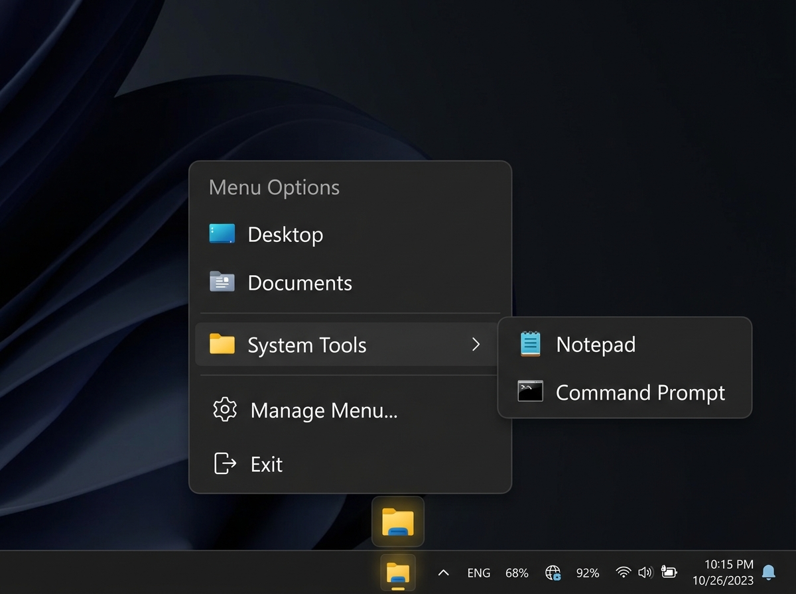
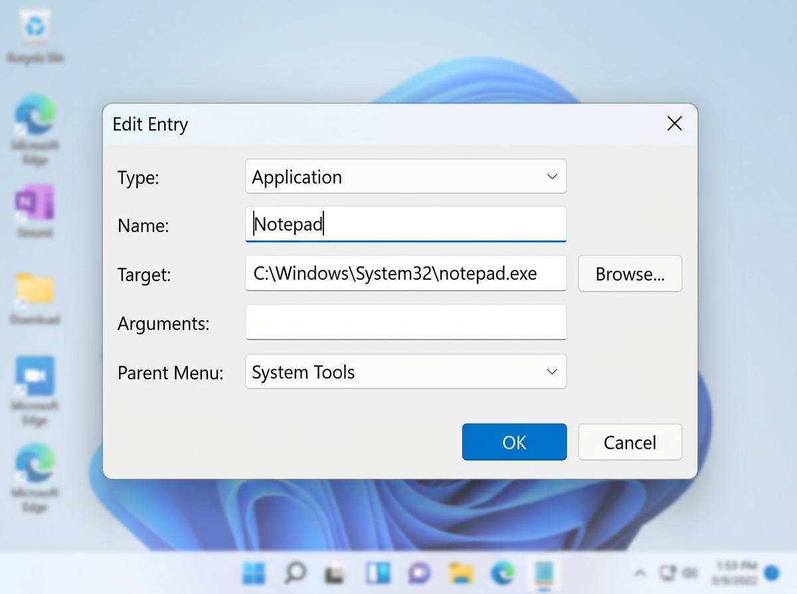

# QuickTray

**QuickTray** est un lanceur rapide natif pour Windows écrit en **langage C Win32 Unicode**, sans aucune dépendance externe (inspiré de *Folder Menu*).

Il s'intègre dans la zone de notification Windows (*System Tray*) et ouvre, d'un simple clic gauche ou droit, un menu hiérarchique contenant vos dossiers, applications, sous-menus et séparateurs favoris.

---

## Captures d'écran

### Menu contextuel dans la barre des tâches (Mode sombre)



### Gestionnaire de menu (Mode sombre)


### Édition d'une entrée (Mode clair)



---

## Fonctionnalités

- **100 % Win32 Unicode natif** : aucune bibliothèque tierce, uniquement les API standard de Windows (`user32`, `shell32`, `comctl32`, `comdlg32`, `ole32`, `uxtheme`, `dwmapi`, `shlwapi`).
- **Menu rapide complet** : lancement d'applications (avec arguments optionnels et répertoire de travail automatique), ouverture de dossiers dans l'Explorateur, sous-menus imbriqués et séparateurs visuels.
- **Icônes système natives** : extraction des icônes Windows via `SHGetFileInfoW` avec conversion en `HBITMAP` ARGB 32 bits pour un rendu net en mode clair comme en mode sombre.
- **Adaptation automatique au thème Windows** : détection de `AppsUseLightTheme` et mise à jour en direct via `WM_SETTINGCHANGE` (menus contextuels `uxtheme`, barre de titre `DwmSetWindowAttribute` et contrôles).
- **Interface multilingue automatique** : détection de la langue Windows (`GetUserDefaultUILanguage`) avec prise en charge de l'**anglais**, du **français** et de l'**espagnol**.
- **Gestionnaire intégré** : arborescence `SysTreeView32` pour ajouter, modifier, réorganiser (`Monter` / `Descendre`), insérer des séparateurs ou supprimer des entrées, avec sélecteurs natifs de fichiers et de dossiers.
- **Configuration portable en UTF-16 LE** : sauvegarde automatique dans `QuickTray.ini` (UTF-16 LE avec BOM) à côté de l'exécutable ; un menu de départ est généré automatiquement au premier lancement.
- **Instance unique** : mutex nommé empêchant les doublons ; un second lancement ouvre directement le menu de l'instance active.

---

## Compilation (Windows / MinGW-w64)

### Prérequis

- **MinGW-w64** (`gcc`, `windres`, `mingw32-make.exe` ou `mingw64-make`) disponible dans le `PATH`.

### Lancer la compilation

Via le script batch (encodé en Windows-1252) :

```bat
build.bat
```

Ou directement via `Makefile` :

```bat
mingw32-make.exe
```

Ou avec `mingw64-make` :

```bat
mingw64-make
```

Pour nettoyer les fichiers objets (`obj/*.o`, `obj/*.res`) et l'exécutable :

```bat
build.bat clean
```

L'exécutable généré est `QuickTray.exe` à la racine du projet.

---

## Structure du projet

```text
QuickTray/
├── src/                # Sources C, en-têtes, ressources (.rc, .ico, .manifest)
├── obj/                # Fichiers objets et ressources compilées (généré)
├── docs/screenshots/   # Captures d'écran de présentation
├── Makefile            # Script de compilation MinGW (mingw32-make / mingw64-make)
├── build.bat           # Lanceur de compilation Windows-1252
└── README.md           # Présentation du projet
```

---

## Configuration (`QuickTray.ini`)

Au premier démarrage, `QuickTray.exe` crée automatiquement un fichier `QuickTray.ini` (encodé en **UTF-16 LE avec BOM**) dans le même dossier que l'exécutable. Vous pouvez gérer toutes les entrées directement depuis l'option **Gérer le menu...** du menu de notification.
