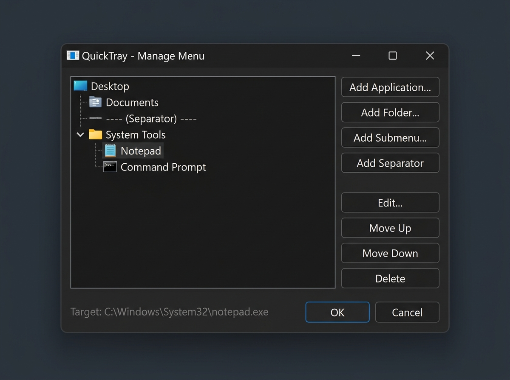

# QuickTray

**QuickTray** is a native quick launcher for Windows written in **Win32 Unicode C**, with zero external dependencies (inspired by *Folder Menu*).

It integrates into the Windows notification area (*System Tray*) and opens, with a simple left or right click, a hierarchical menu containing your favorite folders, applications, submenus, and separators.

---

## Screenshots

### System Tray Context Menu (Dark Mode)


### Menu Manager (Dark Mode)



### Editing an Entry (Light Mode)


---

## Features

- **100% Native Win32 Unicode**: No third-party libraries—only standard Windows APIs (`user32`, `shell32`, `comctl32`, `comdlg32`, `ole32`, `uxtheme`, `dwmapi`, `shlwapi`).
- **Complete Quick Menu**: Launch applications (with optional arguments and automatic working directory), open folders in File Explorer, and organize nested submenus and visual separators.
- **Native System Icons**: Extracts Windows icons via `SHGetFileInfoW` and converts them to 32-bit ARGB `HBITMAP` images for crisp rendering in both light and dark modes.
- **Automatic Windows Theme Adaptation**: Detects `AppsUseLightTheme` and updates live via `WM_SETTINGCHANGE` (`uxtheme` context menus, `DwmSetWindowAttribute` title bars, and controls).
- **Automatic Multilingual UI**: Detects the Windows UI language (`GetUserDefaultUILanguage`) with built-in support for **English**, **French**, and **Spanish**.
- **Built-in Manager**: `SysTreeView32` tree view to add, edit, reorder (`Move Up` / `Move Down`), insert separators, or delete entries, with native file and folder pickers.
- **Portable UTF-16 LE Configuration**: Automatically saved to `QuickTray.ini` (UTF-16 LE with BOM) next to the executable; a starter menu is automatically generated on first launch.
- **Single Instance**: Named mutex prevents duplicate instances; a second launch directly opens the active instance's menu.

---

## Building (Windows / MinGW-w64)

### Prerequisites

- **MinGW-w64** (`gcc`, `windres`, `mingw32-make.exe`, or `mingw64-make`) available in your `PATH`.

### Build Commands

Using the batch script (encoded in Windows-1252):

```bat
build.bat
```

Or directly via `Makefile`:

```bat
mingw32-make.exe
```

Or with `mingw64-make`:

```bat
mingw64-make
```

To clean object files (`obj/*.o`, `obj/*.res`) and the executable:

```bat
build.bat clean
```

The generated executable is `QuickTray.exe` in the project root.

---

## Project Structure

```text
QuickTray/
├── src/                # C sources, headers, resources (.rc, .ico, .manifest)
├── obj/                # Compiled object and resource files (generated)
├── docs/screenshots/   # Presentation screenshots
├── Makefile            # MinGW build script (mingw32-make / mingw64-make)
├── build.bat           # Windows-1252 build launcher
└── README.md           # Project presentation
```

---

## Configuration (`QuickTray.ini`)

On first startup, `QuickTray.exe` automatically creates a `QuickTray.ini` file (encoded in **UTF-16 LE with BOM**) in the same folder as the executable. You can manage all entries directly from the **Manage Menu...** option in the system tray menu.
